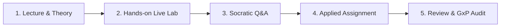

# Enterprise Pharma AI Seminar & Masterclass Guide

**A practical manual for instructors, facilitators, and enterprise coordinators.**

## Start here

| If you need to… | Go to… |
| --- | --- |
| Present or share the curriculum | [Open the interactive syllabus](index.html) |
| Plan the agenda | [Seminar tracks](#4-timed-agendas-by-seminar-track) |
| Prepare the environment and material | [Pre-seminar checklist](#5-pre-seminar-technical-checklist--setup-requirements) |
| Evaluate participant work | [Review rubric](#pillar-5-peer-reviews-evaluations--gxp-audit-checklists-10-of-time) |

> **Use and compliance note:** This material is educational, not legal, regulatory, or validation advice. Before using AI in a regulated workflow, have the organization’s Quality, Privacy, Security, and Legal teams confirm the intended use, vendor terms, access controls, validation evidence, records, and required approvals. Never use real patient data, proprietary formulas, or unapproved clinical content in a demonstration.

---

## 1. Overview & Purpose
This document accompanies [index.html](index.html) located in this directory. It serves two primary functions:
1. **Interactive Navigation Guide**: How to operate, demonstrate, and navigate the curriculum website during executive pitches, client meetings, and live seminar presentations.
2. **Pedagogical Delivery Framework**: A comprehensive execution blueprint detailing how to structure the seminar across **Lectures, Hands-On Labs, Q&A Checkpoints, Practical Assignments, and Review Sessions**.

---

## 2. Navigating `index.html` During Presentations

The `index.html` file is designed as a standalone, zero-dependency, ultra-responsive web application that functions both as a presentation dashboard and a downloadable course syllabus.

### Key Navigation Sections & Features:
* **Top Navbar**:
  * **Brand Badge (`PharmaAI Masterclass`)**: Instantly resets to the top hero section.
  * **Quick Navigation Links**: Smoothly scroll to `Overview`, `Core Concepts`, `Curriculum Modules`, `Prompt Library`, `Security & GxP`, and `Seminar Tracks`.
  * **Instructor Guide (`README.md`) Link**: Direct navigation to this facilitator manual.
  * **Theme Toggle (Sun/Moon icon)**: Switches between dark mode (optimal for high-contrast digital displays) and light mode (recommended when projecting on conference room projectors or bright lecture halls).
  * **Print / PDF Button**: Activates a customized print stylesheet (`@media print`) that strips UI navigation, auto-expands all modules with `beforeprint`, and restores the participant's original view state upon completion (`afterprint`).
  * **Mobile Navigation**: Below 1280px viewport width, the navbar collapses into an accessible hamburger menu with an overlay backdrop for touch-friendly navigation.
  * **Back-to-Top Button**: Appears after scrolling 600px to smoothly return to the hero section (hidden during print/PDF export).
  * **Screen-Reader Live Region**: Copy actions, dynamic filter counts, and theme changes are cleanly announced via a dedicated `aria-live="polite"` region (`#srStatus`).
  * **Book Seminar Button**: Smoothly jumps down to the speaker/booking contact card.

* **Hero Section & Meta Overview**:
  * Displays the core enterprise pillars: Microsoft Copilot Enterprise, GxP & 21 CFR Part 11, RAG & Audio AI, and Local ETL Pipelines.
  * Four quick-glance cards summarizing business impact across M365, ETL, local AI, and security boundaries.

* **Search & Topic Filter Controls**:
  * **Search Bar**: Live-filters modules and glossary cards as you type (e.g., typing `Excel`, `Whisper`, `RAG`, or `Temperature` instantly isolates matching content and expands relevant modules).
  * **Category Filter Pills**: Click `All Modules`, `Foundations & Glossary`, `M365 Copilot`, `RAG, Audio & ETL`, or `Security & Compliance` to tailor the view for specific audience tracks (e.g., filtering for IT architects vs. quality assurance managers).

* **Core Terminology & Concepts Grid (`#glossary`)**:
  * 14 essential cards demystifying AI fundamentals (AI, LLM, RAG, Agents, Context Engineering, Vectors, Temperature, MCP, Local AI, Fine-Tuning vs RAG, Multimodal AI, LLMOps & Guardrails, GAMP 5 / ALCOA+, and RAG Evaluation Triad).
  * Each card includes a dedicated green **"Pharma Context"** box providing life-sciences analogies (e.g., comparing statistical solubility models to generative text models, or why temperature=0.0 is non-negotiable for regulatory reporting).

* **Curriculum Modules Accordion (`#modules`)**:
  * Modules 01 through 06 with duration tags and audience badges.
  * Click any module header to expand or collapse detailed subtopics, learning outcomes, and interactive lab previews.

* **Interactive Prompt Bank (`#prompts`)**:
  * 4 categorized tabs: **Microsoft Word**, **Microsoft Excel**, **Microsoft PowerPoint**, and **Python & ETL**.
  * Each prompt features a 1-click **"Copy"** button with toast notification feedback and an explanation of why the prompt structure works in pharma.

* **Security, Retention & GxP Matrix (`#governance`)**:
  * A 4-tier data classification table (*Public*, *Confidential Corporate*, *Clinical/Patient PHI*, *Core Intellectual Property*) contrasting consumer ChatGPT vs. Microsoft Copilot Enterprise vs. Air-Gapped Local AI.
  * 4 compliance cards addressing Zero Data Retention (ZDR), 21 CFR Part 11 electronic records, GAMP 5 / ALCOA+ data integrity, and hallucination defenses with RAG Triad benchmarking.

---

## 3. Seminar Delivery Architecture: The 5-Pillar Methodology

To deliver maximum retention, executive confidence, and hands-on capability in a corporate pharmaceutical setting, every module follows a balanced **5-Pillar Pedagogy**:

### Pillar 1: Lecture & Conceptual Grounding (25–30% of time)
* **Goal**: Establish rock-solid conceptual clarity without unnecessary mathematical bloat.
* **Format**: Visual slide walk-through, architecture diagrams, and real pharma analogies.
* **Key Focus**:
  * Explain *why* LLMs work probabilistically (next-token prediction) and why they are not relational databases.
  * Contrast consumer AI tools with enterprise-licensed data boundaries (Commercial Data Protection).
  * Address the core fear: *"Will this model leak our drug formula or train future public models?"*

### Pillar 2: Hands-On Live Labs (35–40% of time)
* **Goal**: Immediate practical application directly inside tools the company uses daily.
* **Format**: The instructor demonstrates live on screen, followed by attendees executing alongside on their own laptops.
* **Exercises Include**:
  * **Word**: Taking a messy 5-page lab protocol and generating an ICH-compliant Standard Operating Procedure (SOP) with automated QA placeholders.
  * **Excel**: Writing complex nested formulas for Out-of-Specification (OOS) stability testing and normalizing mixed-format patient demographic strings.
  * **PowerPoint**: Transforming a multi-page clinical trial dossier into a 6-slide executive presentation with distinct visual concepts and talking points.
  * **Python/ETL**: Running a local script that uses Pydantic to extract adverse reactions into strict, database-ready JSON.
  * **Audio Transcription**: Ingesting a recorded clinical discussion into Whisper with pharma vocabulary priming to eliminate medical acronym errors.

### Pillar 3: Interactive Q&A & Socratic Checkpoints (15% of time)
* **Goal**: Dispel skepticism, address departmental edge cases, and align with corporate governance.
* **Facilitation Strategy**:
  * Dedicate 10 minutes at the end of each module for open questions.
  * Use "Socratic Checkpoints" to test understanding (e.g., *"If a doctor's note mentions an adverse drug event, why should we never ask Copilot for a creative narrative?"*).
  * Address enterprise IT and QA concerns directly (data retention policies, SOC2 Type II, ISO 27001, tenant boundary guarantees).

### Pillar 4: Applied Assignments & Team Challenges (15% of time)
* **Goal**: Validate that participants can engineer solutions independently.
* **Format**: Small groups (2–3 colleagues) or individual tasks using simulated pharmaceutical datasets:
  * **Challenge A (Regulatory Track)**: Draft a Plain-Language Summary (PLS) for a Phase III trial that achieves a Flesch-Kincaid readability score $\le 8$ without dropping any critical adverse event warnings.
  * **Challenge B (Data/ETL Track)**: Build a prompt chain or Python script that ingests 20 raw patient adverse event logs, maps them to standard MedDRA terms, and flags records requiring immediate safety officer escalation.
  * **Challenge C (Commercial/Leadership Track)**: Convert competitor FDA drug approval announcement data into a 4-slide competitive intelligence briefing for executive leadership.

### Pillar 5: Peer Reviews, Evaluations & GxP Audit Checklists (10% of time)
* **Goal**: Enforce quality control, accuracy verification, and regulatory compliance.
* **Evaluation Criteria / Scoring Rubric**:
  1. **Hallucination Rate**: Are all factual and numerical statements strictly traceable to the source context?
  2. **Format Adherence**: Did the output respect structural constraints (JSON schema, SOP numbering, slide layout)?
  3. **Data Boundary Safety**: Did the prompt avoid leaking unnecessary confidential identifiers or unmasked PHI?
  4. **Human Verification Sign-Off**: Does the final document include an explicit reviewer verification stamp as required by 21 CFR Part 11?
  5. **ALCOA+ & GAMP 5 Audit Trail Integrity**: Are model seeds, prompt versions, retrieved source chunk IDs, and raw inputs logged for inspection readiness?

---

## 4. Timed Agendas by Seminar Track

### Track A: Full-Day Corporate Seminar (8 Hours)
| Time | Session | Format | Topics Covered |
| :--- | :--- | :--- | :--- |
| **09:00 - 10:15** | **Session 1: Demystifying AI & LLMs** | Lecture + Q&A | AI vs ML vs GenAI, tokens, context limits, next-token prediction, fine-tuning vs RAG trade-offs, why models hallucinate. |
| **10:15 - 10:30** | *Morning Break & Coffee* | — | Networking & informal questions. |
| **10:30 - 12:00** | **Session 2: Microsoft Copilot Enterprise Mastery** | Hands-On Lab | Word for SOPs & CSRs, Excel for clinical batch data, PowerPoint executive decks. |
| **12:00 - 13:00** | *Networking Lunch* | — | — |
| **13:00 - 14:30** | **Session 3: RAG Architectures & Audio Intelligence** | Lecture + Live Demo | How RAG works over SOPs/protocols, vector embeddings, Whisper speech-to-text, PII redaction, RAG Triad evaluation. |
| **14:30 - 15:45** | **Session 4: Applied Pharma Team Challenge** | Hands-On Assignment | Teams solve Challenge A (SOP synthesis) or Challenge B (MedDRA adverse event extraction). |
| **15:45 - 16:00** | *Afternoon Tea Break* | — | — |
| **16:00 - 17:00** | **Session 5: Security, Retention, GxP & Governance** | Lecture + Discussion | Tenant boundaries, Zero Data Retention, 21 CFR Part 11 compliance, GAMP 5 & ALCOA+ standards, "Can this be shared?" matrix. |
| **17:00 - 17:30** | **Session 6: Review, Audit & Action Roadmap** | Review + Q&A | Assignment evaluations, feedback, distribution of cheat sheets and prompt banks. |

---

### Track B: Executive Half-Day Primer (4 Hours)
* **Hour 1 (09:00 - 10:00)**: Executive Landscape: Generative AI reality vs. hype in pharmaceuticals, fine-tuning vs RAG decision matrix.
* **Hour 2 (10:00 - 11:00)**: Copilot Enterprise capabilities, limitations, and operational ROI across M365.
* **Hour 3 (11:15 - 12:15)**: Enterprise IP safety, data retention policies, GAMP 5 risk models, and FDA/EMA regulatory compliance.
* **Hour 4 (12:15 - 13:00)**: Strategic roadmap discussion, prioritization matrix, and executive Q&A.

---

### Track C: 2-Day Engineering & Technical Deep Dive (16 Hours)
* **Day 1**: Modules 01, 02, and 04 (Foundations, Hyperparameters, Embeddings, LoRA/QLoRA fine-tuning tradeoffs, Copilot Deep-Dive, Office Scripting).
* **Day 2**: Modules 03, 05, and 06 (Building RAG from scratch, Whisper local pipelines, RAGAS/TruLens Triad evaluation, Python Pydantic ETL, Local air-gapped Ollama/vLLM models, GAMP 5 / 21 CFR Part 11 automated testing).

---

## 5. Pre-Seminar Technical Checklist & Setup Requirements

Before conducting the seminar, verify the following prerequisites with the corporate IT liaison:

### 1. Environment & Licensing Check
* [ ] Verify attendee access to **Microsoft 365 Copilot** (Enterprise license with Commercial Data Protection enabled).
* [ ] Confirm attendees have permissions to use Copilot within Word, Excel, and PowerPoint desktop/web applications.
* [ ] For technical tracks: verify access to Python 3.10+ environments (Jupyter Notebook, VS Code, or Azure ML Studio).

### 2. Sample Data Preparation
* [ ] Ensure all datasets used in labs and assignments are **synthetic or fully anonymized** (no active patient identifiers or unfiled patent formulas).
* [ ] Prepare mock stability CSVs, sample protocol PDFs, and simulated investigator meeting audio recordings (MP3/WAV).

### 3. Audio & Video Setup
* [ ] High-resolution projector or large monitor supporting 1080p/4K display.
* [ ] Test browser display of `index.html` in Light Mode to ensure high contrast in ambient room lighting.
* [ ] Audio playback capability for Whisper speech-to-text audio demonstration.

---

## 6. How to Use the Materials Post-Seminar
* **Printable Syllabus**: Share the exported PDF of `index.html` as an official training record.
* **Prompt Bank Reference**: Encourage teams to bookmark [`index.html#prompts`](index.html#prompts) on their corporate intranet for daily copy-pasting.
* **Governance Guide & Matrix**: Share the 4-Tier Data Classification Matrix from [`index.html#governance`](index.html#governance) with the internal QA and compliance committee for integration into standard operating procedures (bookmark for quick reference).

---

## 7. Dynamic Navigation & Portfolio Links
* **Seminar & Curriculum Application**: [Open Interactive Curriculum (index.html)](index.html)
* **Main Consulting Portfolio**: [Return to Krishna Kanth B AI Consulting Portfolio (../index.html)](../index.html)

